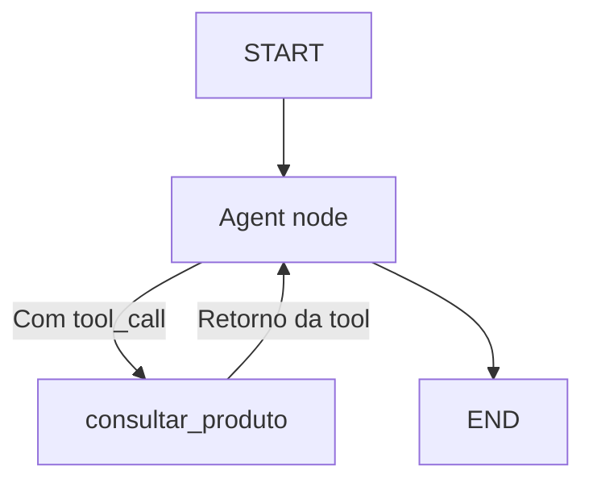
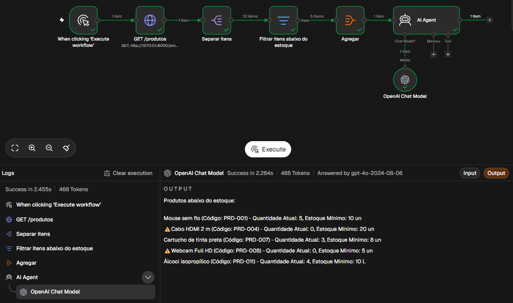

# Agents A.V.A. - Agente de Estoque

Este repositório demonstra o uso de um agente de IA para consultar dados fictícios de estoque.
A aplicação combina uma API REST em FastAPI, um agente construído com LangGraph e LangChain,
cenários de execução e um workflow opcional no n8n.

## Estrutura do projeto

| Caminho | Responsabilidade |
|---|---|
| [`agent.py`](agent.py) | Configura o modelo, valida o contrato Pydantic, cria a tool e compila o grafo LangGraph |
| [`api-estoque/`](api-estoque/) | API FastAPI de consulta e cadastro de produtos |
| [`api_test.py`](api_test.py) | Verificação simples da resposta da API |
| [`N8N_workflow.json`](N8N_workflow.json) | Workflow n8n com agente, modelo OpenAI e processamento dos produtos pelo script de restauração |

## Fluxo do agente e da tool call



O grafo possui dois nós principais:

- **`agent`**: envia as instruções do sistema e o histórico ao modelo com a tool vinculada.
- **`consulta`**: executa `consultar_produto` por meio do `ToolNode`.

Se o modelo decidir usar a tool, o fluxo volta ao nó `agent` após o `ToolMessage`.
Caso contrário, o grafo segue diretamente para `END`.

## A tool `consultar_produto`

A tool recebe um código no formato `PRD-XXX` e chama `GET /produtos/{codigo}`.

| Resultado | Identificador normalizado |
|---|---|
| Produto encontrado | `ok: true` com os dados do produto |
| Código inválido | `codigo_invalido` |
| Produto inexistente | `produto_nao_encontrado` |
| Timeout | `tempo_esgotado` |
| API indisponível | `servico_indisponivel` |
| Resposta incompatível com Pydantic | `resposta_invalida` |
| Outro erro HTTP | `falha_http` |

A tool só realiza consultas HTTP. Ela não altera nem cadastra produtos.

## Cenários executados

O `agent.py` executa quatro cenários ao iniciar:

| Cenário | Pergunta | Tool esperada | Resultado do agente |
|---|---|---|---|
| T1 | Nome e quantidade de `PRD-001` | Sim | Resposta com consulta válida |
| T2 | Consulta de `PRD-9999` | Sim | Código inválido |
| T3 | Conceito de produto em estoque | Não | Resposta em texto |
| T4 | Pergunta ambígua sobre estoque mínimo | Não | Solicitar esclarecimento


## Pré-requisitos

- Python 3.11 ou superior
- Conta e credencial da OpenAI
- API FastAPI disponível em `http://127.0.0.1:8000`

## Configuração

Crie um arquivo `.env` na raiz do repositório:

```dotenv
OPENAI_API_KEY=sua-chave
OPENAI_MODEL=gpt-4.1-mini
API_URL=http://127.0.0.1:8000
PRODUTO_DEMO=PRD-001
```

A chave não deve ser adicionada ao controle de versão.
O modelo padrão é `gpt-4.1-mini`, a API padrão é `http://127.0.0.1:8000`
e o código demonstrativo padrão é `PRD-001`.

Crie o ambiente virtual e instale as dependências:

```powershell
python -m venv .venv
.venv\Scripts\Activate.ps1

python -m pip install fastapi uvicorn pydantic pytest httpx python-dotenv
python -m pip install langchain langchain-openai langgraph
```

## Executando a API

Na raiz da pasta `api-estoque`:

```powershell
cd api-estoque
python -m uvicorn app.main:app --reload --host 127.0.0.1 --port 8000
```

Em outro terminal, confirme o funcionamento:

```powershell
curl http://127.0.0.1:8000/health
```

## Executando o agente

Com a API em execução e o ambiente virtual ativo, na raiz do repositório:

```powershell
python agent.py
```

O programa verifica `/health`, valida um produto de demonstração com Pydantic,
cria e testa a tool diretamente e executa os cenários T1 a T4.

Para fazer uma verificação rápida isolada da API:

```powershell
python api_test.py
```

## Endpoints utilizados

| Método | Endpoint | Uso |
|---|---|---|
| `GET` | `/health` | Verificar a disponibilidade da API |
| `GET` | `/produtos/{codigo}` | Consultar um produto pelo código |
| `GET` | `/produtos` | Listar produtos |
| `GET` | `/categorias` | Listar categorias |
| `POST` | `/produtos` | Cadastrar produto |

A documentação interativa fica em `http://127.0.0.1:8000/docs`.

## Testes da API

Na pasta `api-estoque`:

```powershell
python -m pytest
```

Os testes que alteram dados usam uma cópia temporária da base e não modificam
`api-estoque/data/produtos.json`.

Para restaurar a base ativa manualmente:

```powershell
cd api-estoque
python scripts/reset_data.py
```

## Workflow n8n



[`N8N_workflow.json`](N8N_workflow.json) contém um fluxo complementar com:

1. gatilho manual;
2. `GET /produtos`;
3. separação e filtro dos itens com quantidade abaixo do estoque mínimo;
4. agregação dos resultados;
5. agente com modelo OpenAI;
6. saída textual dos produtos encontrados.

Importe o arquivo no n8n e configure separadamente a credencial da OpenAI.

## Segurança e limitações

- Não exponha a chave da OpenAI ou publique o arquivo `.env`.
- A API de demonstração não possui autenticação e deve permanecer local.
- `consultar_produto` é somente leitura.
- Os dados são persistidos em JSON local e não substituem um banco transacional.
